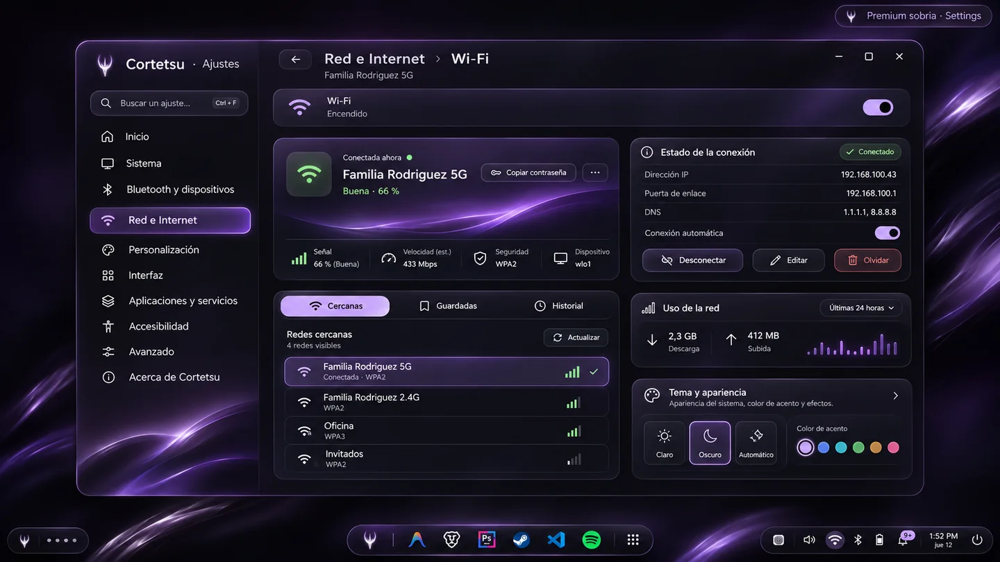
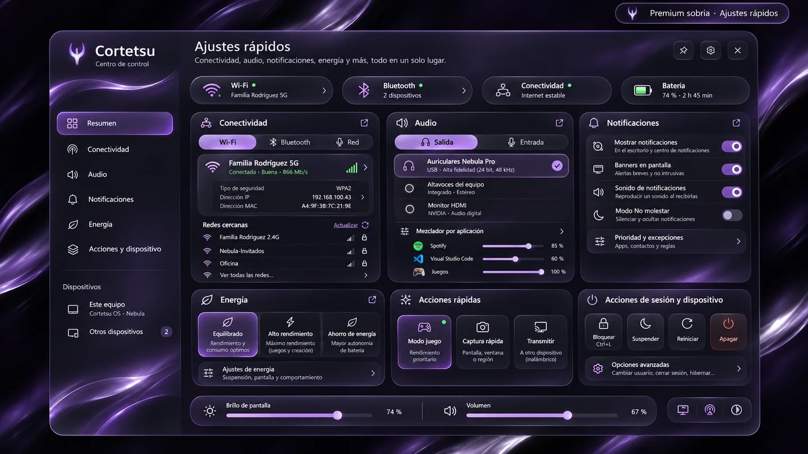
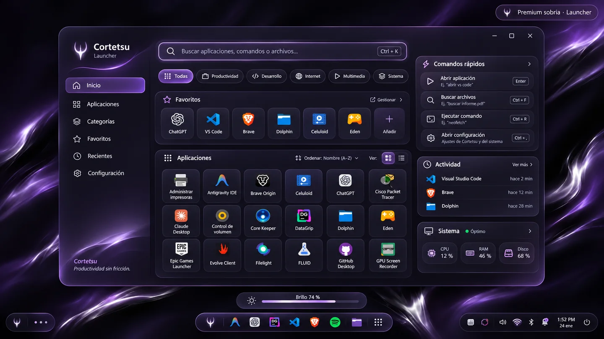
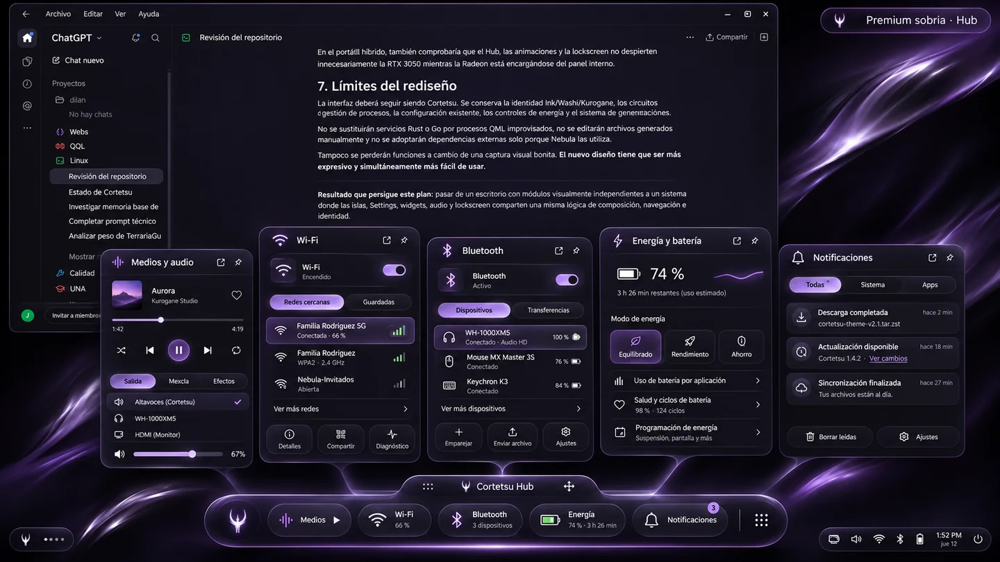
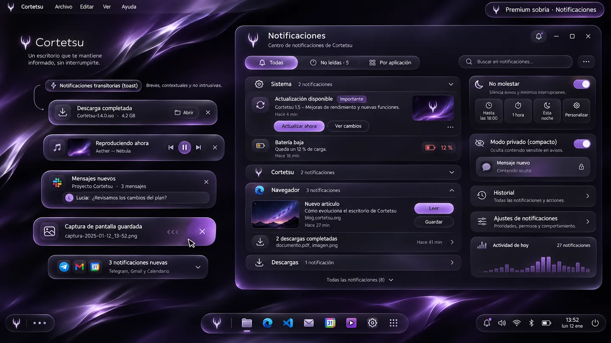
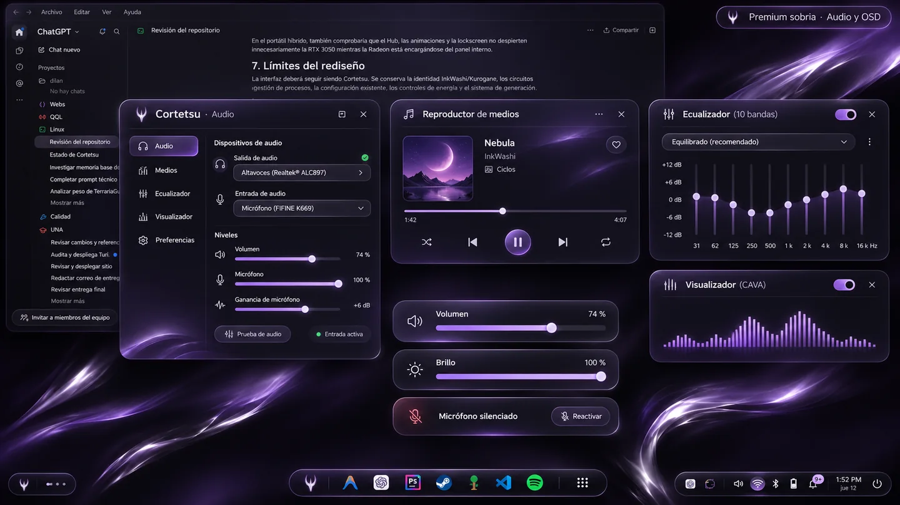
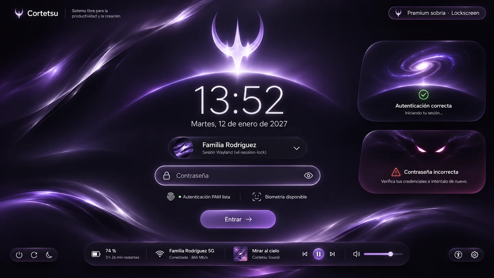
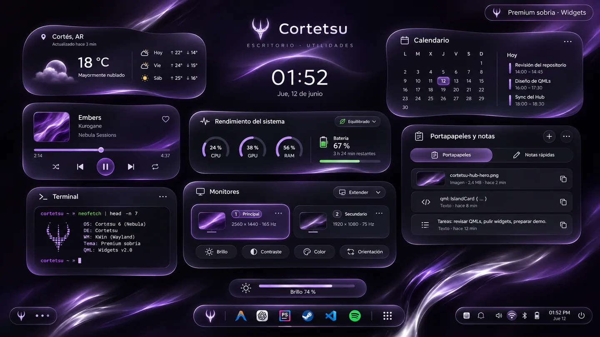

# Cortetsu 3.0 - Plan maestro de producto, diseño, arquitectura y certificación

> **Estado del documento:** dirección visual **Premium sobria** seleccionada por el propietario. La implementación, benchmarks, QA física y publicación **no** se han realizado por crear este plan. Ningún mockup prueba que un control o un dato funcione.
>
> **Fuente de verdad:** repositorio Cortetsu `main` y su checkout real al iniciar el trabajo; el HEAD público consultado el 12-11-2026 fue `97d40b4caab84e214889ea89f3409e5cee98cb66`. Nebula `main` se revisó en `0028e65cb3479d49fd36506c9eb038c62140233e` como referencia, no como código a integrar directamente. Revalidar ambos si cambian.
>
> **Advertencia de contexto:** no se recuperó el archivo de proyecto `MIGRACION_PROYECTO_ARCH_2026-09-02.md`. Antes de cambiar código, leerlo si está disponible, y confrontar cualquier dato histórico con el sistema real.

## Índice

1. [Visión, alcance y decisiones vinculantes](#1-visión-alcance-y-decisiones-vinculantes)
2. [Diagnóstico y evidencia](#2-diagnóstico-y-evidencia)
3. [Sistema visual Premium sobria](#3-sistema-visual-premium-sobria)
4. [Identidad Evolving Mark](#4-identidad-evolving-mark)
5. [Arquitectura y contratos de interacción](#5-arquitectura-y-contratos-de-interacción)
6. [Hub multiposición e islas](#6-hub-multiposición-e-islas)
7. [OSD y Ajustes rápidos](#7-osd-y-ajustes-rápidos)
8. [Servicios de conectividad, audio, energía y avisos](#8-servicios-de-conectividad-audio-energía-y-avisos)
9. [Settings, Launcher y el resto del escritorio](#9-settings-launcher-y-el-resto-del-escritorio)
10. [Lockscreen](#10-lockscreen)
11. [Catálogo de mockups y trazabilidad QML](#11-catálogo-de-mockups-y-trazabilidad-qml)
12. [Rendimiento, seguridad, accesibilidad y pruebas](#12-rendimiento-seguridad-accesibilidad-y-pruebas)
13. [Roadmap de diez fases](#13-roadmap-de-diez-fases)
14. [Criterios de release, riesgos y rollback](#14-criterios-de-release-riesgos-y-rollback)
15. [Handoff para implementación y registros](#15-handoff-para-implementación-y-registros)
16. [Fuentes](#16-fuentes)

---

## 1. Visión, alcance y decisiones vinculantes

### 1.1 Resultado que debe entregar Cortetsu 3.0

Cortetsu 3.0 debe convertir un conjunto de QML visualmente fragmentados en **un escritorio coherente, accesible, rápido y con identidad propia**. El diseño ha de poder reconocerse al ver el Hub, Settings, OSD, Launcher, la pantalla de bloqueo, notificaciones o cualquier control contextual, sin que esas superficies parezcan copias unas de otras.

**Premium sobria** significa:

- Negro tinta y grafito, con elevación sutil; materiales propios de Cortetsu, no una imitación genérica de glassmorphism.
- Radios y siluetas moderados; menos paneles cuadrados dentro de paneles cuadrados, sin convertir todo en burbujas o piezas orgánicas gigantes.
- Transparencia controlada, legibilidad robusta y una jerarquía evidente entre información principal, detalles y acciones.
- Acento índigo/violeta contenido, bordes finos, profundidad sin halos decorativos constantes y movimiento breve con propósito.
- Emblemas oficiales de Cortetsu usados de forma protagonista pero **selectiva**.
- Más capacidad funcional en el Hub, OSD, red, Bluetooth, audio, batería, notificaciones y multimedia, usando servicios reales y compartidos.
- Posicionamiento del Hub en bordes y esquinas con adaptación correcta al monitor, orientación y escalado.
- Comportamiento coherente en CachyOS/Arch, Hyprland y Wayland, respetando la arquitectura híbrida AMD/NVIDIA.

### 1.2 Decisiones aprobadas, no pendientes

| Decisión | Contrato |
| --- | --- |
| Dirección | **Premium sobria**, aprobada a partir de la quinta serie de conceptos visuales. |
| Temas | **Ink, Washi y Kurogane** siguen siendo temas; Premium sobria es su **lenguaje de composición compartido**, no un cuarto tema forzoso. |
| Identidad | Usar solo los SVG del **Evolving Mark**: Human, Awakening, Monster, Ascended y Cosmic. No redibujar ni regenerar marcas. |
| Bloqueo | **Ascended** mientras está bloqueado; **Monster** cuando falla PAM; **Cosmic** después del éxito de PAM, antes de liberar la escena. |
| Hub | Renombrar la denominación visible **Bottom Hub** a **Hub**, con 8 anclajes y orientación adaptativa por monitor. |
| Superficies | Rediseño transversal, no solo Settings: Hub, islas, popouts, OSD, Quick Settings, Launcher, lockscreen, notificaciones, widgets, dashboard y el resto de QML visibles. |
| Comportamiento | No perder ninguna función por motivos estéticos; no declarar completado por CI sin QA real. |
| Arquitectura | Conservar gestión de procesos, Rust/Go, Quickshell, servicios compartidos, tokens compilados y generaciones con rollback. |

### 1.3 No objetivos

- No reemplazar Cortetsu por Nebula, end-4, Caelestia u otro shell.
- No adoptar M3Shapes/Material 3 como dependencia obligatoria; evaluar solo si hay una necesidad real, costos aceptables y mecanismo de mantenimiento reproducible.
- No eliminar las identidades de Ink/Washi/Kurogane en favor de un único morado oscuro.
- No copiar SVG de los conceptos generados: las imágenes pueden inventar emblemas, textos, versiones, hardware o indicadores.
- No instalar paquetes ajenos al gestor ni usar symlinks para simular compatibilidad ABI.
- No introducir un servicio de red/audio/energía por cada widget ni `sh -c` en QML como arquitectura regular.
- No publicar como v3.0.0 hasta cerrar los criterios del apartado 14.

### 1.4 Reglas de interpretación de los mockups

Los ocho renders en `assets/` son **referencias visuales**: jerarquía, ritmo, composición, siluetas, profundidad y tono. No son requisitos literales para nombres de apps, datos meteorológicos, temperaturas, fondos de pantalla, modelos de auriculares, potencia de GPU, versiones de Cortetsu ni sistemas operativos. Ejemplos de datos inexactos en renders: `Cortetsu OS`, `KWin`, resoluciones inventadas, auriculares que podrían no existir y baterías con ciclos/salud simulados.

No se mostrará "Copiar contraseña" de Wi-Fi sin una vía autorizada y segura de acceso a secretos. No se afirmará que hay una función de punto de acceso, cast, VPN, salud de batería, compartir archivos o controles por aplicación si el backend no los admite de verdad.

---

## 2. Diagnóstico y evidencia

### 2.1 Punto de partida real

Las capturas del propietario muestran tres problemas transversales: exceso de **rectángulos anidados**, espacios con poca función y controles de sistema presentados como indicadores más que como centros de control. Se notan especialmente en Settings (Wi-Fi), en los mosaicos de Ajustes rápidos y en el Launcher.

El repo publicado contiene ya varias piezas maduras que deben reutilizarse:

- `cortetsu/modules/BottomHub.qml` y `CortetsuBottomHubView.qml`: controlador y vista first-party separados.
- `cortetsu/modules/osd/{Wrapper,Content,FullContent,MiniSlider}.qml`: OSD y utilidad actual.
- `cortetsu/modules/settings/Content.qml`, `SettingsController.qml`, `PageRegistry.qml`, `SettingsHeader.qml`, `controls/` y `sections/`: Settings con categorías y deep links.
- `cortetsu/modules/launcher/{Wrapper,Content,AppList,ContentList}.qml`: búsqueda y composición Launcher.
- `cortetsu/modules/lock/{Lock,LockSurface,LockCard}.qml`, `cortetsu/base/modules/lock/Pam.qml`: bloqueo de sesión y autenticación PAM.
- `cortetsu/services/{Audio,Players,CortetsuPower,ConnectivityBluetooth,CortetsuSettingsNetwork}.qml` y `cortetsu/modules/CortetsuNotifications.qml`: fuentes de estado; **verificar la fuente efectiva** en la generación instalada.
- `cortetsu/components/CortetsuEvolvingMark.qml` y `assets/branding/`: identidad vigente.
- `cortetsu/platform-rs/templates/`, `cortetsu/theme/`, `dotfiles/home/.config/cortetsu/ui.toml`: contratos y proyecciones de temas.
- Pruebas QML, scripts de verificación, Agent Realms, documentación física y generaciones de sistema ya existentes.

La documentación histórica marca muchas superficies como **VERIFIED**; eso no significa que el nuevo aspecto esté verificado ni que el estado de un monitor o driver de noviembre siga vigente.

### 2.2 Problemas concretos a corregir o confirmar

| Hallazgo/hipótesis | Acción exigida |
| --- | --- |
| Lista de Wi-Fi y detalles con alturas mínimas de aproximadamente 580 px observadas en el código revisado | Evitar contenedores altos cuando solo hay una red; usar altura basada en contenido, scroll adecuado y layout responsive. |
| `FullContent.qml` usa una superficie amplia de aproximadamente 520 px y un conjunto de mosaicos | Distinguir el **OSD transitorio** del **Centro de control interactivo**. No hacer que cambiar brillo abra una ventana enorme. |
| `MiniSlider.qml` actual es básico | Incorporar jerarquía semántica: icono, nombre, valor, estado, barra si aplica, posición contextual y respuesta instantánea. |
| Launcher con tarjeta por icono y nombres recortados | Densidad adaptable, etiqueta legible, selección clara y alternativas lista/cuadrícula según espacio. |
| Paneles de red/Bluetooth/audio/energía repartidos entre popouts y Settings | Compartir datos, acciones y errores, y ampliar la profundidad operativa de los popouts. |
| Áreas transparentes del Hub interceptan interacción si la máscara no coincide con las islas | Revisar la región interactiva real en las ocho posiciones y al expandir popouts. |
| `LockCard.qml` distingue `Failed` y `MaxTries` con precedencia que puede ocultar el mensaje de bloqueo por intentos | Reproducir, corregir estado, añadir test y comprobar que PAM sigue siendo la única autoridad de desbloqueo. |
| Captura de escritorio bajo el bloqueo | Evaluar privacidad; preferir wallpaper o una versión segura, con captura opt-in y opacidad suficiente. |
| Servicio de lectura de LED de teclado por superficie de lock | Compartir lectura/eventos entre monitores cuando corresponda. |

### 2.3 Protocolo antes de tocar el checkout

1. `git status --short --branch`, `git branch --show-current`, `git rev-parse HEAD`, comparación con `origin/main`; no sobrescribir cambios ajenos.
2. Identificar al propietario de cada archivo: Git, XDG runtime mutable, generado por compilador, paquete de pacman, o usuario no versionado.
3. Identificar generación activa y anterior, unidades systemd --user, paquete/kernel/driver reales y matriz de monitores actual.
4. Respaldar lo que **no** está protegido por Git; no copiar a ciegas rutas administradas por paquetes.
5. Capturar baseline de screenshots por superficie y tema, PSS/CPU/GPU/latencias, logs QML, hilos/procesos y estado RTD3.
6. Cargar, si existe, `MIGRACION_PROYECTO_ARCH_2026-09-02.md` como restricción histórica; verificar los datos temporales.
7. Trabajar sobre la rama correspondiente y cambios acotados. No publicar, instalar ni reiniciar la sesión sin autorización explícita para esas acciones.

---

## 3. Sistema visual Premium sobria

### 3.1 Filosofía de composición

**Estado antes que decoración.** Cada vista debería contestar primero qué ocurre, qué puedo hacer y qué cambiará. Mostrar detalle bajo demanda, no cinco recuadros explicando lo mismo.

**Densidad equilibrada.** Reducir espacios vacíos sin comprimir texto; usar anchos legibles y altura determinada por contenido, con breakpoints probados. Las listas de un elemento no deben ocupar de forma artificial casi toda la ventana.

**Familias de forma, no radio global.** Propuesta inicial, pendiente de prototipado/QA:

| Forma | Uso | Comportamiento visual |
| --- | --- | --- |
| `Frame` | Ventana y superficies principales | Superficie continua, borde discreto, pocos cortes. |
| `Section` | Una agrupación lógica | Separación por contraste/espacio antes que otro marco completo. |
| `Island` | Hub, popout, control flotante | Silueta suave, elevación contenida, sin brillo persistente. |
| `Row` | Listas y propiedades | Filas abiertas con separador fino; contenedor solo en selección/hover. |
| `Pill` | Pestañas, chips y estado | Capsular donde facilita lectura o toque; no aplica a todo. |
| `Hero` | Conexión activa, multimedia, estado destacado | Un bloque protagonista con información de primer nivel. |
| `Danger` | Olvidar red, apagar, fallo PAM | Bermellón semántico, confirmación y contraste. |

Los valores finales de radio, padding, outline, blur y animación se resuelven en tokens por tema y estado, no se inventan dentro de cada archivo QML. Los números de los mockups no son especificaciones técnicas.

### 3.2 Los tres temas bajo una misma gramática

- **Ink:** expresión de referencia de Premium sobria. Sumi, transparencia contenida, índigo, profundidad leve, bordes finos, jerarquía nítida.
- **Washi:** mismos layout/controles/estados, pero superficies luminosas tipo papel, sombra suave, texto oscuro y acento que cumpla contraste. No una versión oscura translúcida recoloreada.
- **Kurogane:** acero mate, trazos y biseles sobrios, densidad algo mayor y esquinas más firmes. **Mantener su identidad angular sin repetir cajas opacas alrededor de cada elemento.**

La documentación actual de temas especifica radios/densidades distintos (incluso controles cuadrados para Kurogane). Esta fase **propone revisar ese contrato deliberadamente**, no cambiarlo por accidente. Si se aprueban nuevos rangos, actualizar fuentes declarativas, pruebas de contraste y evidencias de los tres temas.

### 3.3 Tokens y material

- Semántica: `surface.base`, `surface.elevated`, `surface.glass`, `surface.strong`, `text.primary`, `text.secondary`, `accent`, `danger`, `success`, `focus`, `separator`, `shadow`, `scrim`; son **roles conceptuales** que se mapearán a nombres reales verificados en la fuente del compilador.
- Geometría: radios por rol, separación, altura de fila/control, ancho máximo legible, márgenes per-monitor y hit targets.
- Tipografía: escala coherente; respetar la familia declarada y fallback real, sin prometer fuentes no instaladas. Iconos Material Symbols Rounded con verificación de `fontconfig`.
- Motion: latencia perceptiva baja, pressed/hover claros, transiciones deliberadas y rutas **reducedMotion**. Una transición no puede habilitar por sí misma una operación de seguridad.
- Transparencia: configurable, compatible con tema claro/opaco y entorno con wallpaper ruidoso. Mantener legibilidad sin fondos negros completamente opacos por defecto.
- Elevación: pocos niveles constantes; no combinar sombra, borde y glow fuerte en todas las superficies.
- Responsividad: textos sin clipping y cambios de columna por geometría útil real, no por suposición de 1920 px fijos.

**Fuente de verdad real para estilo:** `dotfiles/home/.config/cortetsu/ui.toml`, `cortetsu/platform-rs/templates/theme-profiles.json`, `theme-metadata.json`, preferencia validada y compilador `cortetsu theme compile`. `cortetsu/theme/CortetsuDesign.qml` es salida generada: **no editarla a mano**. `cortetsu theme check` debe pasar tras cambios.

### 3.4 Primitivas QML a evolucionar

Investigar y extender las existentes antes de crear variantes: `CortetsuSurface`, `CortetsuInkPanel`, `CortetsuButton`, `CortetsuToggle`, `CortetsuSlider`, `CortetsuListRow`, `CortetsuChoiceCard`, `CortetsuActionTile`, `CortetsuTab`, `CortetsuSectionHeader`, `CortetsuPopupSurface/Host`, `CortetsuEvolvingMark` y su tipografía. Cada cambio debe mantener `disabled`, `hover`, `pressed`, `focus-visible`, `selected`, teclado, ratón y accesibilidad.

Evitar forks visuales aislados de cada componente. Si se necesita una nueva primitiva, documentar cuándo se usa, qué reemplaza y cómo se prueba.

---

## 4. Identidad Evolving Mark

**Assets oficiales (no se modifican):**

- `cortetsu/assets/branding/cortetsu-mark-human.svg`
- `cortetsu/assets/branding/cortetsu-mark-awakening.svg`
- `cortetsu/assets/branding/cortetsu-mark-monster.svg`
- `cortetsu/assets/branding/cortetsu-mark-ascended.svg`
- `cortetsu/assets/branding/cortetsu-mark-cosmic.svg`

`Ascended` sigue siendo el emblema estático aprobado. El renderer contextual `CortetsuEvolvingMark.qml` es quien decide tamaño, alineación y transformación.

| Lugar | Norma |
| --- | --- |
| Hub principal | Emblema visible y legible, sin convertir cada botón en una marca. |
| Settings | Identidad en el encabezado/navegación, de tamaño distinguible; no marcas redundantes en cada sección. |
| Launcher / Dashboard | Marca protagonista pero subordinada al campo de búsqueda, las apps o la información principal. |
| OSD | Firma visual muy discreta o prescindible si competiría con un valor urgente. |
| Bloqueo | Ascended = bloqueado, Monster = fallo, Cosmic = autenticación correcta. |
| Resto de aplicaciones | Usar iconos funcionales para acciones; emblema en superficie anfitriona o identidad del producto cuando aporte valor. |

La secuencia **Ascended / Monster / Cosmic** para la lockscreen es una decisión explícita del propietario y sustituye las asignaciones antiguas de bloqueo documentadas en `docs/design/CORTETSU-PRODUCT-REBUILD.md`. Registrar la nueva decisión mediante ADR y actualizar la documentación cuando se implemente. Human y Awakening se conservan para otros ciclos de evolución, no se borran.

---

## 5. Arquitectura y contratos de interacción

### 5.1 Separación obligatoria

```text
Fuentes reales / capacidades: PipeWire, NetworkManager, BlueZ, UPower,
Hyprland, systemd --user, PAM, notificaciones, media, archivos, estado
                           |
          servicios propietarios / contratos IPC
                           |
       modelos de vista, intents y permisos
                           |
  Hub / Popout / Quick Settings / Settings / OSD / Widgets
```

- **Servicios:** estado, comandos, errores, único propietario de recurso y persistencia duradera.
- **Modelos de vista:** traducción a datos/acciones simples y consistentes.
- **Componentes:** renderizar, aceptar entrada, emitir intenciones; no ejecutar directamente procesos de sistema cuando haya owner del servicio.
- **Hosts:** superficies Wayland, monitor de destino, exclusividad, foco, Escape, cierre externo, autohide, regiones interactivas y z-order.
- **IPC:** extender el contrato existente versionado; no crear canales locales paralelos sin ADR y pruebas de compatibilidad.

Conservar `CortetsuShellState`, `CortetsuScreenState`, `RetainedSurfacesHost`, `SettingsHost`, `LauncherHost` y las reglas de foco/guard de fullscreen que el repo ya mantiene. Identificar el owner real de Quick Settings (en la rama actual existen `utilities/` y OSD) antes de reubicar la UI.

### 5.2 Profundidad progresiva compartida

| Nivel | Lugar | Contrato |
| --- | --- | --- |
| 0 | Icono/status en Hub | Estado fiable, corto, no repetitivo; click primario claro. |
| 1 | Popout del Hub | Operaciones frecuentes y estados asociados; no necesita abrir Settings. |
| 2 | Quick Settings / Centro de control | Varios dominios coordinados, controles expandidos y navegación contextual. |
| 3 | Settings | Configuración completa, diagnóstico, confirmaciones y permisos. |

Una operación solo existe una vez en backend. Las superficies pueden exponer distintas profundidades, pero deben compartir resultados y errores. No confundir 4 niveles de UX con 4 servicios residentes.

### 5.3 Persistencia y migración

- Preferencias editables: conservar `~/.config/cortetsu/preferences.json` y sus esquemas actuales; proponer migración versionada y valores predeterminados antiguos si se añaden posiciones del Hub o visibilidad de widgets.
- Colores/selección de tema: conservar `~/.local/state/cortetsu/scheme.json` y el flujo de proyecciones nativas.
- Config declarativa generada: respetar `ui.toml`, compilador y manifest. No agregar nuevos archivos de preferencias sin necesidad justificada.
- Durante upgrade/rollback, preservar ubicaciones por monitor, modo de movimiento reducido, selecciones de audio, DND y favoritos; una preferencia desconocida debe fallar de forma explícita y segura.
- No mezclar datos de runtime cambiantes con una generación inmutable.

---

## 6. Hub multiposición e islas

### 6.1 Nuevo alcance

La denominación visible es **Hub**. El nombre de archivo `BottomHub.qml` puede mantenerse temporalmente por compatibilidad interna hasta migración segura; no renombrar todo en un commit masivo.

**Ocho anclajes configurables, por salida:**

| Borde | Posiciones |
| --- | --- |
| Superior | `top-left`, `top-center`, `top-right` |
| Lateral | `middle-left`, `middle-right` |
| Inferior | `bottom-left`, `bottom-center`, `bottom-right` |

`bottom-center` es la ubicación de compatibilidad inicial. Se permite mover con modo edición y snapping a un anclaje; no arrastrar accidentalmente mientras se intenta usar la barra.

### 6.2 Geometría y orientación

1. Crear **modelo de anclaje** con salida, rectángulo utilizable, escala, safe margin, orientación, lado de expansión y estado autohide.
2. Superior/inferior: tres islas en horizontal. Izquierda/derecha: distribuir contenidos verticalmente; **no rotar texto ni iconos** para aparentar una barra vertical.
3. Esquinas: composición compacta y expansión hacia el interior; colisión con esquinas, bordes, ventanas fullscreen, OSD y otros overlays.
4. Separar la geometría del Hub de la geometría del popout: abrir hacia donde hay espacio, con `flip`/clamp si el panel no cabe. Diseñar para doble monitor con escalas diferentes.
5. Regiones interactivas/mascara: solamente las islas y popouts capturan ratón, no todos los píxeles transparentes de una franja completa.
6. Respectar foco teclado, tab/shift+tab, menús SNI nativos, contextos de tray, controles de aplicaciones abiertas y drag de app rail.
7. Si cambia/disconecta un monitor, reasignar o restaurar anclaje sin dejar una superficie invisible bloqueando entrada; guardar preferencia por identificador estable verificado.
8. Durante fullscreen y modo juego respetar guard existente y políticas de visibilidad; no cambiar composición de usuario de manera sorprendente.

### 6.3 Tres islas, un sistema

| Isla | Contenido central | Conducta |
| --- | --- | --- |
| **Núcleo** | Evolving Mark, sesiones, espacios de trabajo, lanzador, estado | Estado claro; logo visible, workspace selection accesible. |
| **Aplicaciones** | Dock, favoritas, ventanas, previews, menús, acciones | Resize/flick si excede el espacio; preserva orden y ventanas activas. |
| **Sistema** | Audio, Wi-Fi, Bluetooth, batería, notificaciones, reloj, sesión | Indicadores sobrios con paneles profundos por servicio. |

**Islas expresivas** = transiciones coordinadas y expansion sin rebotes decorativos, no blobs amorfos. La continuidad visual puede usar interpolación de tamaño, posición, radio y opacidad, pero **debe medirse** contra animaciones basadas en geometría QML real. Evitar `FrameAnimation` permanente en reposo.

### 6.4 Popouts y menús

- Por defecto **un popout activo por monitor/owner**, no cinco abiertos simultáneamente como en la imagen comparativa; varios simultáneos solo si existe una razón de producto y se resuelve formalmente la exclusividad.
- Hover y click no deben competir; no producir menús que aparezcan encima del control equivocado, como se vio en la captura del usuario.
- Tray SNI: menú nativo, segundo nivel, acciones, Escape, foco restaurado y cierre por clic fuera según contrato.
- El tooltip necesita contraste alto, no debe tapar controles esenciales ni salir de pantalla.
- Las superficies se abren en el monitor de la interacción; los eventos de teclado retornan foco a la ventana anterior al cerrar.
- Estados `loading`, `empty`, `error`, `offline`, `permission required`, `disabled`, `success` con acciones reales cuando se muestran.

### 6.5 Cambios por archivo (puntos de partida, no lista cerrada)

`modules/BottomHub.qml`, `BottomHubResolver.js`, `CortetsuBottomHubView.qml`, `CortetsuBottomHubVisibility.qml`, `CortetsuBottomHubHoverTarget.qml`, `CortetsuIsland.qml`, `CortetsuModeSegment.qml`, `CortetsuAppRail.qml`, `CortetsuStatusSegment.qml`, `CortetsuTraySegment.qml`, `bar/popouts/`, `settings/sections/BottomHubSection.qml` y servicios/hosts de menú y monitor según ownership verificado.

---

## 7. OSD y Ajustes rápidos

### 7.1 OSD contextual (cero enfoque)

**OSD** informa una acción ya ocurrida. No es una ventana de ajustes, no requiere ratón y no roba el foco. Los siguientes eventos deben compartir estilo pero no un mismo layout genérico:

- Brillo real, volumen real, mute/unmute de salida y micrófono, cambio de dispositivo, Caps Lock/Num Lock, perfil de energía y grabación.
- Evitar mostrar un control manual para una capacidad sin backend; indicar indisponibilidad de manera discreta cuando corresponda.
- El valor en OSD debe ser **readback confirmado**, no intención asumida de un comando.
- Compacto por defecto; ubicación relativa a monitor y Hub con collision avoidance; modo estándar/ampliado opcional cuando tenga valor.
- Deduplicar eventos cercanos y evitar generar varias superficies a la vez; temporizador solo de vida limitada y visible.
- Al pasar a `reducedMotion`, usar fade discreto o cambio inmediato sin afectar funcionamiento.
- Semántica de error: micrófono silenciado, dispositivo ausente y volumen protegido deben diferenciarse visualmente de simple porcentaje.

### 7.2 Quick Settings es un centro de control diferente

- Tamaño inicial compacto, proporción controlada y sin sidebar gigante; la imagen `02-quick-settings.webp` representa el **estado expandido o ventana de Centro de control**, no la superficie pequeña que sale del Hub en cada click.
- Resumen con audio, conectividad, energía, avisos y acciones; expandir secciones on-demand. Evitar duplicar la misma información en tres tarjetas visibles.
- Wi-Fi en Ajustes rápidos debe ser accionable: si la versión actual contiene un tile `clickable: false`, confirmar la ruta y conectarla a la capacidad ya existente, o marcar por qué es solo estado.
- Sesiones/suspensión/apagado solo con acciones reales, confirmaciones y bloqueo de entrada adecuados; no botones falsos.
- Integración de volumen, brillo y ajustes con `CortetsuAudio`, servicios de brillo y `CortetsuPower` sin duplicar residentes.

**QML iniciales:** `modules/osd/{Content,FullContent,MiniSlider,Wrapper}.qml`, `modules/utilities/{Wrapper,Content}.qml`, `settings/sections/OsdSection.qml`, `settings/sections/AudioSection.qml`, `CortetsuOverlayConfig.qml`, hosts de superficies/foco; contrastar la ruta activa con la generación real.

---

## 8. Servicios de conectividad, audio, energía y avisos

Cada servicio tiene la misma estrategia: **nivel 0 estado, nivel 1 popout, nivel 2 centro de control, nivel 3 Settings**, sin segundo backend residente.

### 8.1 Audio y multimedia

- Estado de sink/source y volumen/mute con lectura de vuelta; nombres reales de dispositivos, conexiones HDMI/BT y distinción input/output.
- Mix por aplicación solo cuando PipeWire exponga nodos/streams controlables; controles ausentes no deben inventarse.
- Reproducción MPRIS: track, carátula, tiempo, controles, player activo y estados sin reproductor. Sin bloquear UI por carátula o URL remota.
- Ecualizador de **10 bandas** como módulo opt-in, con bypass, presets persistentes, límite de ganancia, protección frente a clipping, recovery al caer filter-chain y control de procesos propiedad de Cortetsu. No usar `pkill` global.
- CAVA opcional, solo si es visible y hay justificación de actividad; parar el proceso y liberar recursos al cerrarse, no despertar GPU dedicada por decoración.
- Un solo ownership PipeWire; auditar conflictos con otras apps, WirePlumber, perfiles de dispositivo y audio del TV.
- QML objetivo: `services/Audio.qml`, `services/Players.qml`, `modules/CortetsuAudio.qml`, `bar/popouts/CortetsuAudioPopup.qml`, widgets de media y controles Settings.

### 8.2 Wi-Fi / NetworkManager

- Encendido, scan con debounce, redes cercanas y guardadas, selección, conexión, desconexión, olvido confirmado, actualización y errores legibles.
- Detalles útiles: interfaz, seguridad, IP, DNS, puerta de enlace, señal, costo/estado si está disponible, y privacidad para datos sensibles.
- Credenciales: ninguna copia o revelado de contraseña sin permiso y UX seguro; no guardar secretos en logs.
- No mostrar velocidades/volúmenes históricos fabricados. `NetworkUsage.qml` puede respaldar métricas si realmente las publica.
- QML objetivo: `modules/CortetsuNetwork.qml`, `services/CortetsuSettingsNetwork.qml`, `utils/NetworkConnection.qml`, `settings/NetworkPage.qml`, `settings/network/`, `bar/popouts/CortetsuNetworkPopup.qml`.

### 8.3 Bluetooth / BlueZ

- Adapter on/off, scan limitado, emparejamiento y autorización, conectar/desconectar, dispositivos conocidos, perfil de audio cuando soportado, eliminación confirmada.
- Batería de auriculares, ratón o teclado **solo si existe propiedad BlueZ fiable**; no inferir porcentaje de un icono.
- Estado del proceso de pairing claro, tiempo de espera, error, cancelación, petición de PIN/passkey y permisos de dispositivos.
- QML objetivo: `services/ConnectivityBluetooth.qml`, `settings/bluetooth/`, `bar/popouts/CortetsuBluetoothPopup.qml` y sus modelos first-party.

### 8.4 Batería y energía

- Estado UPower real, porcentaje, AC, descarga/carga, estimación cuando existe, perfiles reales de energía, inhibidores y efectos de modo juego.
- Salud, ciclos, consumo por app y tiempo restante solo cuando el sistema los expone de forma verificable. `unknown` es un estado válido.
- No imponer dGPU a widgets ligeros. Asegurar que el modo de ahorro reduzca tareas visuales sin cambiar las preferencias manuales de potencia inesperadamente.
- QML objetivo: `services/CortetsuPower.qml`, `bar/popouts/CortetsuBatteryPopup.qml`, `settings/sections/PowerSection.qml`, `hardware/` y la UI de modo juego.

### 8.5 Notificaciones

- Historial consistente con toasts; agrupación por app, filtros y búsqueda en memoria/almacenamiento existente, solo si se justifica.
- Acciones D-Bus reales, cerrar, descartar, marcar leído cuando haya estado propio y DND consistente.
- Modo privado: ocultar asunto/contenido sensible en lockscreen y durante screen share/fullscreen si está configurado.
- Buen comportamiento con ráfagas, apilamiento, timeout, foco y multimonitor. No sonido/animación invasiva por defecto.
- QML objetivo: `modules/CortetsuNotifications.qml`, `modules/CortetsuNotificationModel.js`, `modules/notifications/`, `modules/sidebar/`, `modules/utilities/toasts/`, Settings Notificaciones.

### 8.6 Contrato universal de funcionalidad

Todo tile muestra acción sólo si existe handler real. Un placeholder `clickable: false` nunca parecerá un interruptor funcional. Toda operación asíncrona tiene resultado, error y reintento seguros, y su estado se refleja sin discrepancia en Hub, Quick Settings y Settings.

---
## 9. Settings, Launcher y el resto del escritorio

### 9.1 Settings completo: reconstruir composición, no funciones

La arquitectura real de Settings ya conserva el enfoque categoría > subpágina > control, búsqueda que enfoca resultados, breadcrumbs, estado de guardado y enlaces antiguos. Se mantienen.

**Cambio de lenguaje:** una sola jerarquía de secciones, superficies más abiertas, radios por rol, encabezado con marca legible, controles alineados, ausencia de espacios forzados, distinción de operaciones peligrosas y layout ajustable. La descripción del problema original Wi-Fi se usa como prueba de estrés.

| Sección actual de Settings | Evolución obligatoria |
| --- | --- |
| Inicio | Vista de estado con prioridades, accesos frecuentes y errores relevantes, sin meter todos los indicadores en tarjetas idénticas. |
| Sistema / Pantalla | Topología comprensible, pantallas eDP/HDMI, modo, frecuencia, escala, preview con timeout, Keep/Revert y consentimiento en cambios disruptivos. |
| Sistema / Sonido | Audio de salida/entrada, mixer soportado, visualizador, controles PipeWire, acceso a EQ opcional. |
| Sistema / Energía | Carga, perfiles, inhibidores, suspensión y diagnóstico disponible, con estados reales. |
| Sistema / Atajos | Descubribilidad, búsqueda, conflictos y contexto de teclado; no duplicar atajos globales sin verificación. |
| Sistema / Captura | Screenshots/recording con fuente y destino claros, permiso, indicador de grabación, y proceso propio. |
| Bluetooth y dispositivos | Lista de dispositivos, estados de pairing, errores, selección y acciones claras. |
| Teclado y entrada | Layouts, foco, toggles reales, teclas especiales y estado de accesibilidad. |
| Red e Internet / Wi-Fi | Compactar listas de una red, hero de conexión, propiedades, guardadas, errores, acciones seguras. |
| Personalización / Temas | Ink/Washi/Kurogane con previsualización fiel y variaciones Premium sobria, fuentes compiladas. |
| Personalización / Colores | Origen auto/manual, esquemas, persistencia, previews y rollback de proyecciones. |
| Personalización / Fondo | Mantener selector orbital y prefetch limitado; transformar su envoltorio al nuevo lenguaje. |
| Personalización / Hub | Selector visual de ocho anclajes, edición por monitor, densidad, islas, autohide, ancho y orientación. |
| Personalización / Paneles | Posición, animaciones, transparencia, uso de monitor correcto, guard de fullscreen. |
| Interfaz / Lanzador | Compacto/extenso, favoritos, categorías, orden, búsqueda, tipos de resultados y atajos. |
| Interfaz / Notificaciones | Permisos por fuente si es posible, prioridades, DND, privacidad y toasts. |
| Interfaz / Indicadores | OSD, reloj, formatos, dispositivo activo y configuración de eventos. |
| Aplicaciones y servicios | Automatización, clima y aplicaciones: visualización solo de capacidades respaldadas por owner. |
| Accesibilidad | Contraste, fuentes, teclado, indicadores, zoom/escala y `reducedMotion` comprobado. |
| Avanzado | Estado y recuperación de sincronización, perfiles, logs, diagnóstico y compatibilidad. |
| Acerca de Cortetsu | Identidad oficial, componentes, versión real/generación, créditos y estado de servicios. |

**Reglas medibles:**

- No forzar igual altura para lista y panel de detalle cuando el contenido real es distinto.
- Mantener el contrato de anchos legibles `SettingsPage.qml` (referencia publicada: `form` hasta 780 px, `wide` hasta 1120 px, dos columnas desde 900 px), ajustarlo **solo si una prueba justifica el cambio**.
- Verificar al menos 1368x900, 880x620, 1100x720 @ 1.25, 1920x1080 y escalas reales instaladas.
- Búsqueda abre página exacta, hace scroll al control, conserva back stack y estado del foco. Scroll tras volver se conserva.
- Controles destructivos diferencian selección, confirmación y resultado. Las redes guardadas no se borran por un clic accidental.
- Los botones, switches, selects, dropdowns y paginación obedecen la misma librería visual, no un estilo distinto por sección.
- Dropdowns **nunca transparentes hasta resultar ilegibles**; panel de opciones debe tener contraste y capa de input correcta.

**Archivos base:** `modules/SettingsHost.qml`, `modules/settings/{Content,SettingsController,SettingsHeader,SettingsContext,PageRegistry,Nexus,NetworkPage}.qml`, `settings/controls/*.qml`, `settings/sections/*.qml`, `settings/pages/*.qml`, `settings/network/*.qml`, `settings/bluetooth/*.qml`, `settings/display/*.qml`. Usar el `PageRegistry` activo para hacer inventario completo; la lista no sustituye el código.

### 9.2 Launcher / búsqueda

El render `03-launcher.webp` muestra un **modo expandido de exploración**, no justifica convertir cada apertura por SUPER en una ventana gigante. Contrato:

1. **Modo compacto por defecto:** búsqueda enfocada, apps o comandos, resultados visibles y respuesta inmediata.
2. **Explorar:** grid adaptativo, favoritos, categorías, recientes y listas; scroll seguro en monitor estrecho.
3. **Búsqueda:** mantener prefijos reales, teclado y acciones existentes. No ejecutar comandos arbitrarios sin política, feedback ni un gesto explícito.
4. **Lista de apps:** nombres legibles por tooltip/segunda línea/list view, selección perceptible sin un rectángulo alrededor de cada icono inactivo.
5. **Resultados mixtos:** distinguir app, archivo, comando y acción; no anunciar búsqueda de archivos si no existe indexador autorizado.
6. **Foco:** SUPER, Escape, Enter, flechas, mouse, monitor activo, fullscreen guard y retorno al foco anterior.
7. **Progreso de lanzamiento:** no bloquear QML por exec; deduplicar aperturas accidentales y respetar las apps existentes.

**QML:** `modules/LauncherHost.qml`, `modules/launcher/{Wrapper,Content,AppList,ContentList}.qml`, `modules/launcher/services/`, `CortetsuSearchBar` y popouts ligados a la selección.

### 9.3 Dashboard, widgets y utilidades

El render `08-widgets.webp` es un catálogo visual, **no** un mandato de mostrar nueve widgets a la vez. Propuesta:

- Widgets opcionales y modulares por monitor: clima, reloj, calendario, media, batería, red, estadísticas, terminal segura, notas/portapapeles y accesos.
- Posición, escala, agrupación, snapping y edición por monitor, con colisiones evitadas frente a Hub/paneles. Un modo de edición claro con revertir.
- Modelo de visibilidad: oculta, fullscreen, suspensión, pantalla bloqueada, batería y escritorios virtuales.
- No duplicar `Timer`/`Process` por widget; los servicios compartidos exponen sus datos y permiten suscribirse.
- Terminal: solo vista segura/acciones definidas o PTY con ownership y aislamiento explicitados; no ejecutar texto arbitrario en el proceso de la shell por un QML decorativo.
- Calendario y portapapeles: proteger información sensible al bloquear o compartir pantalla, no mostrar textos privados como decoración.
- Conexiones externas (clima, medios) fallan con estado degradado, nunca bloquean el escritorio.

### 9.4 Superficies no cubiertas por los ocho renders

Todas deben adoptar el sistema visual sin perder su comportamiento:

| Superficie | Reglas adicionales |
| --- | --- |
| `Overview` / workspaces | Grid elástico, foco, teclado, arrastre, acciones por ventana, gestión de varias pantallas y fullscreen. |
| `Hardware Center` | Métricas verificadas, valores absent/unknown, lectura AMD/NVIDIA híbrida y gráficos sólo cuando aportan información. |
| `Display Manager` | Preview/Keep/Revert real, salida primaria/secundaria, modos soportados y escala con rollback temporal. |
| `Wallpaper Manager` | Órbita existente, búsqueda, previews y colores; superficie consistente con Premium sobria, sin efectos permanentes caros. |
| `Clipboard` | Historia, pin, acciones y privacidad al bloquear; no almacenar secretos nuevos por defecto. |
| `Calendar` | Localización, agenda, tiempo, multi-monitor, enfoque de teclado y errores de cuenta/servicio. |
| `Recorder` / screenshot | Estado de grabación real, controles por proceso propiedad, permisos, captura correcta por pantalla y formato/destino legibles. |
| `Polkit` / permisos | Claridad, prioridad, cancelación, foco; nunca engañar sobre el origen ni alterar PAM por estética. |
| `Session` / apagado | Riesgo distinguible de acciones simples, confirmación, foco y no autoinvocación por animación. |
| `Tray` / submenus | Tamaño apropiado, iconos SNI reales, mouse y teclado, submenús y cierre consistente. |
| `Focus/Pomodoro` / avisos | Jerarquía y timing claros; no reiniciar ciclos al renderizar. |
| `Game mode` / power | Cambios reversibles de efectos, menos renderizado, respetar perfiles reales. |
| `Keyboard status`, `Active Window`, `Window Info` | Popouts livianos, sin cortar etiquetas ni robar foco. |
| `Weather` / panel lateral | Misma biblioteca, estados offline, tipografía y colores correctos. |

### 9.5 Auditoría exhaustiva de QML

En fase 0 generar un inventario real de cada `.qml` **visual** de la generación instalada y clasificarlo: `owned-first-party`, `compat/upstream`, `generated`, `harness/test`, `dead`, `unknown`. Para cada entrada registrar: owner, tema, superficie, servicio, interacción, estados, prioridades y prueba. No aplicar cambios masivos a QML que sean solo compatibilidad o ya no se rendericen.

---

## 10. Lockscreen

### 10.1 Principios no negociables

`WlSessionLock` realiza el bloqueo Wayland real; PAM es el único autorizador del desbloqueo. `Lock.qml`, `LockSurface.qml`, `LockCard.qml` y el backend PAM mantienen responsabilidades separadas. El fallo de un shader, portada, clima o widget **no puede** bloquear la entrada de credenciales, robar el foco, liberar la sesión ni crear superficies inseguras.

### 10.2 Máquina de estados aprobada

```text
SESSION LOCKED
    |
    v
  ASCENDED  -- contraseña / huella / método autorizado --> PAM WORKING
    ^                                                   |
    |                                                   +-- FAIL --> MONSTER
    |                                                   |             |
    |                                                   |       mensaje y reintento
    |                                                   |             |
    +---------------------------------------------------+-------------+
                                                        |
                                                   PAM SUCCESS
                                                        |
                                                      COSMIC
                                                        |
                                           release seguro de wl_session_lock
```

- **Ascended:** principal y estático/ambiental durante la pantalla bloqueada, incluso cuando se escribe.
- **Monster:** solo tras fallo de autenticación; no fingir un fallo mientras PAM espera. Mostrar mensaje específico y regresar a Ascended al permitir otro intento.
- **Cosmic:** solo después de confirmación PAM real. Animación limitada que no crea autoridad ni sirve como bypass.
- **Human y Awakening:** preservados en activos y posibles transiciones de otros módulos, sin necesidad de incluirlos en este ciclo.

### 10.3 Composición

- Evolving Mark protagonista, reloj legible, fecha, identidad de sesión y campo de contraseña con Caps Lock y errores correctos.
- Media, clima, conectividad y batería de forma secundaria y **solo si no filtran datos privados**. Evitar contraseñas, asuntos de notificaciones y previews de ventanas.
- Fondo: preferir wallpaper procesado a una copia del escritorio; permitir captura solo como opción informada y segura.
- Animaciones de entrada cortas. No copiar los 3400 ms de Nebula; despertar y escribir deben sentirse inmediatos, y el unlock debe depender de PAM, no de la duración de una escena.
- Multimonitor: todas las superficies de bloqueo reciben el estado global, pero un solo owner autentica; la entrada es clara y no hay UI desbloqueada visible en otra salida.
- Error de contraseña, `MaxTries`, método biométrico no disponible, reinicio del daemon y suspensión/reanudación requieren rutas probadas.
- La lockscreen debe tener variante sin efectos, sin media y sin GPU dedicada para modo reducido, fallo de shader y batería.

### 10.4 Validación de seguridad

- PAM success / wrong password / max tries / timeout / cancel / suspend / resume / monitor connect / compositor restart siguiendo políticas Wayland reales.
- Una capa de lock nunca es solo una ventana siempre visible; verificar que el protocolo mantiene la sesión protegida.
- Log sin credenciales, secretos, capturas sensibles ni información biométrica.
- Una nueva escena no puede modificar `pam.d` ni delegar desbloqueo a un callback de QML que represente una animación.
- Revertir automáticamente a una vista mínima si un subcomponente de presentación falla.

---

## 11. Catálogo de mockups y trazabilidad QML

Los siguientes conceptos se incluyen para guiar composición visual. **No** trasladar texto, datos de hardware, logos simulados, contenido ficticio, efectos enormes, menús ubicados fuera de lugar ni múltiples popouts simultáneos como requisito.

### 11.1 Settings



**Aplicar:** mejor ancho, jerarquía de conexión, menos espacios muertos, estado separado de acciones, selección clara y marca visible. **No copiar:** un control de temas incrustado en la página Wi-Fi: pertenece a Personalización. No inventar velocidades de enlace ni estadísticas.

**Archivos:** `SettingsHost.qml`, `settings/Content.qml`, `settings/network/`, `settings/controls/`, `settings/sections/`.

### 11.2 Ajustes rápidos / Centro de control



**Aplicar:** centro de control modular, audio, conectividad, Bluetooth, energía y notificaciones con jerarquía y servicios reales. **No copiar:** tamaño de esta vista como popout cotidiano; usar estado expandido independiente.

**Archivos:** `utilities/`, `osd/FullContent.qml`, componentes de control, IPC/host.

### 11.3 Launcher



**Aplicar:** búsqueda protagonista, apps agrupadas, favoritos, densidad, nombres claros. **No copiar:** un lanzador gigante como modo de búsqueda por defecto; conservar respuesta rápida de SUPER y prefijos actuales.

**Archivos:** `LauncherHost.qml`, `launcher/`, `CortetsuSearchBar`.

### 11.4 Hub y popouts



**Aplicar:** islas visualmente relacionadas, mayor profundidad funcional, logo visible, tray separado, handles de edición solo en modo editar. **No copiar:** cinco paneles abiertos simultáneos como funcionamiento habitual.

**Archivos:** `BottomHub.qml`, `CortetsuBottomHubView.qml`, segmentos, `bar/popouts/`, `BottomHubSection.qml`.

### 11.5 Notificaciones



**Aplicar:** toasts compactos, centro persistente, grupos por app, acciones, DND, privacidad, jerarquía y cierre. **No copiar:** funciones ficticias de actualización ni historiales inexistentes.

**Archivos:** `CortetsuNotifications.qml`, `notifications/`, `sidebar/`, `utilities/toasts/`.

### 11.6 Audio, OSD, CAVA y ecualizador



**Aplicar:** dispositivos, streams, player, ecualizador opcional, visualizador bajo demanda y OSD microcontextual. **No copiar:** audio de prueba ni gains como valores reales del equipo.

**Archivos:** `services/Audio.qml`, `services/Players.qml`, `CortetsuAudio.qml`, `bar/popouts/CortetsuAudioPopup.qml`, `osd/`, `settings/sections/AudioSection.qml`.

### 11.7 Lockscreen



**Aplicar:** reloj, campo claro, profundidad ambiental sobria y visualización de estados. **Obligatorio cambiar respecto al mockup:** usar los tres SVG oficiales, no un tridente generado; Ascended en bloqueo, Monster en fallo y Cosmic en éxito PAM. Los previews de error y éxito son alternativas, **nunca** dos vistas simultáneas visibles en la lockscreen real.

**Archivos:** `modules/lock/`, `base/modules/lock/Pam.qml`, renderer oficial, hosts y servicios permitidos.

### 11.8 Widgets / Dashboard



**Aplicar:** familia de widgets coherente, distribución por monitor, información densa pero legible, modularidad y edit mode. **No copiar:** uso de KWin, `Cortetsu OS`, CPUs, temperaturas, fecha, resoluciones o clima inventados en el render; el equipo real es CachyOS/Hyprland/Wayland y hay que detectar sus salidas.

**Archivos:** `dashboard/`, `background/`, `hardware/`, `services/Weather` si está en la generación, `calendar/`, `clipboard/` y widgets realmente activos.

### 11.9 Patrón para todas las demás superficies

Para un QML sin mockup dedicado, tomar como referencias combinadas `01-settings` (composición), `04-hub` (flotantes y popouts), `05-notifications` (estados) y `06-audio-osd` (controles), pero **adaptar a su tarea**. No imponer la misma malla a Overview, un diálogo PAM y un selector de fondos.

---

## 12. Rendimiento, seguridad, accesibilidad y pruebas

### 12.1 Presupuesto de funcionamiento

**Medir primero**. No convertir metas en resultados observados.

- Baseline: versión local, tema, cantidad de monitores, estado activo/inactivo, procesos, PSS/RSS, cgroup CPU por 60 s, sesiones QML, GPU runtime D3, energía y tiempo de primer frame.
- En reposo: ningún proceso nuevo recurrente debido **solo** al rediseño; no animaciones perpetuas sin efecto visible; no polling por widget si ya existe servicio compartido.
- Escenas cerradas: sin temporizadores de alta frecuencia ni procesos auxiliares persistentes propios.
- Rendimiento de apertura: referencia del repo `docs/PERFORMANCE.md`, primer frame útil idealmente menor de 120 ms; validar en el Victus sin declararlo cumplido antes de medir.
- Animaciones visibles: fluidas en eDP-1 a 144 Hz sin asumir que todos los paneles necesitan renderizar a 144 FPS; mantener sincronía y evitar jank. No despertar NVIDIA cuando la ruta Radeon basta.
- Imágenes: limitar decode y memoria de portadas, wallpapers y thumbnails; reciclar recursos y cancelar trabajo al ocultarse.
- Benchmarks comparables: mismo estado del Hub, mismo monitor, mismo fondo, mismas apps y mismo intervalo de medición; PSS junto a otros indicadores, no RSS aislado.
- Tests de larga vida: 40 aperturas/cierres, hotplug HDMI, cambios de tema, autohide, varios días de suspender/reanudar y ausencia de crecimiento sostenido de recursos.

### 12.2 Matriz de verificación

| Eje | Casos mínimos |
| --- | --- |
| Temas | Ink, Washi, Kurogane; esquema manual y auto; modo claro/oscuro donde corresponda; preview, persistencia y restauración. |
| Superficies | Hub, Settings, Launcher, OSD, Quick Settings, lock, media, notificaciones, widgets, Overview, Hardware, Display, Wallpaper, Session, Polkit, Tray. |
| Monitores | eDP-1 Radeon y HDMI-A-1 NVIDIA cuando disponible; conectar/desconectar, posiciones distintas, per-monitor focus. |
| Hub | Ocho anclajes, vertical/horizontal, corner clamp, drag, autohide, visual en fullscreen, máscara real de clic y popouts. |
| Resolución / escala | 1920x1080 144 Hz de referencia y dimensiones estrechas, 1.0/1.25/otra escala instalada, HiDPI si posible. |
| Entrada | Mouse, teclado, tab/shift-tab, Enter/Space, Escape, wheel, drag, menús y focus restore. |
| Estados | Vacío, cargando, sin permisos, sin dispositivo, offline, fallido, correcto, persistido, reintento, reconexión. |
| Energía | AC, batería, ahorro, modo juego, suspensión, lock, nvidia runtime suspended, fullscreen, media inactiva. |
| Temas y cambios | Edición de un token, `theme compile`, `theme check`, live apply, fallo de proyección y rollback. |
| Seguridad | PAM wrong/max tries/success, lock real, red con credenciales, Bluetooth pairing, Polkit cancel, clipboard privado, recording. |
| Regresión | IPC, tray SNI submenús, notificaciones, wallpaper orbit, audio Bluetooth/HDMI, generación y rollback. |

### 12.3 Pruebas automatizadas y QA real

Aprovechar `cortetsu test`, pruebas Rust/Go/Qt existentes, `cortetsu realm qa .`, visual matrix on-demand, `qml-design-lint.py`, `test-cortetsu-lock*.py` y suites de `tests/qml/`. Los comandos exactos/flags se tomarán de `--help` y docs de la versión instalada antes de ejecutar. El realm anidado no sustituye prueba real de HDMI, PAM de sesión, sensores, RTD3, atajos físicos ni audio en la TV.

Cada fase de UI exige por lo menos: prueba sintáctica, test QML de componente/host, screenshot en los tres temas, lectura de log QML sin errores nuevos, interacción real, teclado, multimonitor cuando el módulo lo requiera y regresión de features.

**Regla de bloqueo:** no testear PAM destructivamente ni reiniciar la sesión real sin plan de recuperación, autorización y forma de desbloquear desde TTY si fuera necesario.

### 12.4 Accesibilidad, privacidad y seguridad visual

- Contraste de texto objetivo WCAG AA cuando aplique, márgenes para antialiasing y fondos reales; probar con wallpaper contrastado.
- Estados de foco siempre visibles, áreas click alcanzables, sin controles solo hover, sin bloqueos de teclado por overlays transparentes.
- `reducedMotion` gobierna todas las animaciones y errores de lock (incluida sacudida), visualizador CAVA y efectos ambientales.
- Legibilidad sin blur/transparencia; modo opaco viable pero no forzado por defecto.
- No revelar contenidos de notificación ni pantallas a usuarios no autenticados; no registrar contraseñas ni tokens.
- Acciones de sesión peligrosas usan color y confirmación apropiados; sin engaños visuales por elementos sin backend.
- Preservar atribución y licencias: la referencia Nebula usa AGPL-3.0; preferir reproducir ideas, no copiar código/recursos, y revisar obligaciones legales ante reutilización literal.

---

## 13. Roadmap de diez fases

Cada fase debe terminar con una entrega funcional, pruebas y estado de evidencia. P0/P1 orientan prioridad, no autorizan saltarse dependencias de seguridad.

### Fase 0 - Congelar baseline y definir mapa de propiedad [P0]

**Acciones:** revalidar git/HEAD local y remoto, generación y servicios; inventariar superficies QML y owners; screenshots y recursos iniciales; revisar docs de identidad y lock, estado de temas y pruebas; clasificar los renders como referencia; crear matriz de trazabilidad QML y un plan de rollback.

**Entregables:** `baseline.json`/tablas equivalentes, checklist de superficies, capturas de Ink/Washi/Kurogane, riesgos reales y lista de migraciones.

**Gate:** baseline reproducible, backups donde hace falta, ninguna modificación de producción sin consentimiento.

### Fase 1 - Biblioteca Premium sobria y marca [P0]

**Acciones:** acordar tokens semánticos, formas por rol, contenedores, controles y tipografía; actualizar fuente declarativa; compilar outputs; contrastes; integrar Evolving Mark oficial, sin regenerar SVG; variantes de accesibilidad y reducedMotion; migrar una superficie piloto.

**Entregables:** librería QML reutilizable, guía de uso, gallery/showcase y screenshots de tres temas.

**Gate:** `theme check`, contrast/keyboard/hover/pressed/focus tests; Kurogane sigue reconocible; no degradar componentes existentes.

### Fase 2 - Settings integral y Launcher [P0]

**Acciones:** rediseñar Settings con prioridad Wi-Fi, aplicar a todas las páginas de `PageRegistry`; eliminar alturas vacías y paneles dobles; unificar selects/scrolls/errores; Launcher compacto/extenso, búsqueda/favoritos/categorías y labels; mantener deep links/legacy y atajos.

**Entregables:** 100% páginas de Settings cubiertas por screenshots y pruebas; Launcher usable en monitores/escala; sin pérdida de controles.

**Gate:** navegación, UI, accesibilidad, backend real y persistencia verdes en tres temas; no marcar fase cerrada por mejorar solo Wi-Fi.

### Fase 3 - Hub multiposición [P0]

**Acciones:** modelo de anclajes, orientación, edit mode y snap, per-monitor preference, guard, autohide, fallo de monitor, desplazamiento de zonas, regiones interactivas; migrar la UI visible de Bottom Hub a Hub con compatibilidad de IPC.

**Entregables:** 8 anclajes efectivos, horizontal/vertical real, persistencia por monitor, selector Settings, funcionalidad anterior preservada.

**Gate:** 8x matriz monitor/escala y mouse/teclado, sin popouts fuera de pantalla, sin captura de clics en huecos, tray y workspace correctos.

### Fase 4 - Islas, popouts y tray [P0]

**Acciones:** morphing sutil, popout anchoring en los ocho lados, menús SNI, prioridades de foco, tooltip, tray y preview; actualizar cada popup first-party y compat donde se necesite, conservar servicios.

**Entregables:** tres islas maduras, popouts contextuales y menús nativos legibles y consistentes.

**Gate:** ningún conflicto de foco/z-order, cero fugas de superficies, tray con teclado y ratón, 40 ciclos de apertura/cierre.

### Fase 5 - OSD 3.0 y Ajustes rápidos [P0]

**Acciones:** separar visualizador transitorio de centro interactivo, rediseñar indicadores por evento, sensor de disponibilidad, deduplicación, anchoring por monitor; controlador Quick Settings con secciones expandibles y owner claro; reconectar tiles de estado a operaciones reales.

**Entregables:** OSD minimal contextual, Centro de control compacto/expandido, sin dos implementaciones conflictivas del mismo servicio.

**Gate:** latencia y foco medidos, readback real, modo juego y reducedMotion, eDP/HDMI, tests y logs limpios.

### Fase 6 - Profundidad de los centros de servicio [P0]

**Acciones:** completar audio output/input/stream, Wi-Fi scan/guardar/conectar, Bluetooth pairing, energía y notificaciones, media; shared state con Settings/Hub; errores, permisos y situaciones de dispositivo ausente.

**Entregables:** operaciones comunes resolubles desde popouts y Quick Settings, sin doble owner y sin datos simulados.

**Gate:** pruebas reales de conectividad, audio PipeWire, Bluetooth, suspensión, permisos y estados degradados. No introducir funciones no soportadas para cumplir mockups.

### Fase 7 - Lockscreen, Dashboard y widgets [P1 con gate de seguridad]

**Acciones:** UI de lock segura con marcas oficiales y estados aprobados, fondo privado, animaciones breves; dashboard y widgets modulares por monitor, configuración, privacidad, modo reducido y visibilidad contextual.

**Entregables:** lock real funcional, temas y mark correctos, widgets por monitor sin polls duplicados.

**Gate:** PAM, max tries, teclado, suspensión, Wayland lock, multi-monitor, privacy, consumo; vista mínima de recuperación.

### Fase 8 - Audio avanzado, temas y superficies restantes [P1]

**Acciones:** EQ PipeWire 10 bandas con bypass, CAVA a demanda, presets, revisión de todos los QML visibles no tratados (Overview, Wallpaper, Hardware, Calendar, Clipboard, Polkit, Session, Recorder...), IPC, persistencia y integraciones de tema.

**Entregables:** inventario de QML visuales cubierto, audio avanzado opt-in y recuperable, tres temas plenamente consistentes.

**Gate:** automatización, visual matrix, rendimiento y seguridad sin regresión; no dejar un grupo de QML con estilo heredado incompatible.

### Fase 9 - Certificación de Cortetsu 3.0 [release gate]

**Acciones:** matriz integrada, baseline antes/después, CI y pruebas físicas, variantes de escala/tema, GPU RTD3, HDMI cuando disponible, install/verify/rollback/shell reload, comprobación de procesos auxiliares, revisión de licencias, docs, novedades y checklist final.

**Entregables:** evidencia versionada, notas de release, informe PASS/FAIL con incertidumbres y procedimientos de rollback.

**Gate:** solo `READY` con todas las pruebas obligatorias reales aprobadas. Si falta HDMI/PAM/suspensión/escala, `DONE_WITH_CONCERNS` o `PARTIAL`, nunca `DONE` por inercia.

### 13.1 Tabla compacta de dependencias

| Fase | Depende de | Bloquea |
| --- | --- | --- |
| 0 | Acceso a checkout y hardware cuando corresponda | Todas |
| 1 | 0 | 2 a 8 |
| 2 | 1 | Certificación visual |
| 3 | 0, 1 | 4, 5, 6 |
| 4 | 3 | Popouts y controles |
| 5 | 1, 3, 4 | Centro de control |
| 6 | 4, 5 | Profundidad funcional |
| 7 | 1 | Release por seguridad |
| 8 | 1, 5, 6, 7 | Cobertura total |
| 9 | 0 a 8 | Release |

La división en fases es para control de regresión. No obliga a cerrar primero toda la fase 6 si un experimento seguro de la fase 7 puede servir de prototipo, pero la certificación exige todos los gates.

---

## 14. Criterios de release, riesgos y rollback

### 14.1 Definición de terminado (DoD)

- [ ] Dirección Premium sobria implementada en **todas** las superficies QML first-party activas, sin estilos cuadrangulares repetitivos no justificados.
- [ ] Ink, Washi y Kurogane conservan identidad y contraste; esquema reactivo y restore funcionan.
- [ ] Evolving Mark usa assets originales; Ascended/Monster/Cosmic obedecen eventos PAM correctos.
- [ ] Hub funciona en ocho anclajes, orientación vertical/horizontal, per-monitor, teclado/ratón, autohide, escalamientos y fullscreen.
- [ ] Todos los popouts interactúan con un solo owner y se colocan dentro de pantalla.
- [ ] OSD no roba foco, ofrece todos los eventos previstos **con backend verificado**; Centro de control es distinto y funcional.
- [ ] Audio, Wi-Fi, Bluetooth, batería y notificaciones tienen estado/acciones/errores idénticos en Hub, Centro de control y Settings.
- [ ] Launcher compacto sigue siendo inmediato y conserva comandos, prefijos, favoritos, teclas y entrada de búsqueda.
- [ ] Wallpaper, Display, Hardware, Dashboard, widgets, session, tray, notifications y Polkit no perdieron comportamientos.
- [ ] No hay fugas, zombies, duplicados de procesos, consultas constantes innecesarias ni activación inesperada de dGPU por UI en reposo.
- [ ] Tests, screenshots, logs y pruebas de hardware documentados; no hay errores nuevos críticos QML.
- [ ] `cortetsu install`, `verify`, `rollback`, `shell reload` y recuperación mantienen contratos (probar orden correcto en staging antes de tocar sesión real).
- [ ] Documentación, changelog, créditos y compatibilidad actualizados; versión v3 solo con aprobación y evidencia.

### 14.2 Riesgos con mitigaciones

| Riesgo | Prevención | Recuperación |
| --- | --- | --- |
| Animación excesiva / PSS alto | Benchmarks por superficie, pausas y reducedMotion | Desactivar efecto por preferencia, rollback de generación |
| GPU NVIDIA activa sin necesidad | Medición sysfs real, pruebas nested y physical | Desactivar efecto/preview, revertir fase |
| Hub invisible por escala/monitor | Safe geometry y fallback `bottom-center` | Reset de preferencia desde CLI/Settings y rollback |
| Popout captura ratón o teclado | Tests de máscara, host, Escape, focus restore | Cerrar/suspender host, recarga o rollback |
| Fallo de lock/auth | Separación de PAM/UI, test seguro, vista mínima | TTY/recuperación documentada; no desactivar el bloqueo |
| Pérdida de redes/BT/volumen | Owner único, operaciones asíncronas con rollback | Reconectar desde backend; restaurar preferencia |
| Tema roto o generado stale | Compilar fuente, comprobar contrato, matrices visuales | `theme check` y rollback por generación |
| Diferencias en paquetes del host | `doctor`, pacman y versiones actuales verificadas | Degradar capacidad con honestidad, no inventar compat |
| Archivos ajenos sobrescritos | Clasificar owner, backups y Git status | Restaurar backup y manifest anterior |
| Fork o copia sin atribución | Revisar procedencia y licencias antes de copiar | Revertir código ajeno y corregir atribuciones |

### 14.3 Comandos de verificación y recuperación

Usar **solo** si la versión instalada confirma estas suboperaciones (según README/ayuda). No ejecutarlos automáticamente por leer el plan:

```sh
git status --short --branch
git branch --show-current
git rev-parse HEAD
pacman -Q quickshell hyprland 2>/dev/null
cortetsu status
cortetsu doctor
cortetsu test
cortetsu theme check
cortetsu verify
journalctl --user -u cortetsu-shell.service -n 120 --no-pager
```

**Después de pruebas y solo con autorización:** documentación actual referencia `cortetsu install` para promover generación, `cortetsu shell reload` para adoptar sin cierre duro y `cortetsu rollback` para revertir. No asumir que `install` reinicia la shell; de hecho el README explica lo contrario. Antes de ejecutar rollback, identificar `previous` y sus manifiestos; preservar los archivos editables del usuario y medir el resultado real.

---

## 15. Handoff para implementación y registros

### 15.1 Orden de trabajo para un agente o contribuidor

1. Leer este plan, `README.md`, `docs/IDENTITY.md`, `docs/SETTINGS.md`, `docs/THEMING.md`, `docs/CORTETSU_DESIGN_SYSTEM.md`, `docs/PHYSICAL_QA.md` y ADRs relevantes.
2. Leer `MIGRACION_PROYECTO_ARCH_2026-09-02.md` si es accesible; tratarlo como contexto, no como estado actual de paquetes o código.
3. Verificar rama/HEAD, `git status`, owner de archivos, generación instalada, servicios y dispositivos. No tocar cambios no relacionados.
4. Tomar baseline primero. Implementar una sola fase o subentrega funcional a la vez con commit(s) temáticos; los archivos generados se producen mediante el compilador.
5. Mantener servicios Rust/Go e IPC; QML compone, no crea daemons de nuevo. Reutilizar componentes y actualizar tests.
6. Ejecutar pruebas estáticas, QML real, visual matrix y QA física donde aplica. Documentar limitaciones, no fingir PASS.
7. Validar hot reload, install/verify/rollback bajo controles de riesgo; sin permisos de publicación, dejar cambios para revisión sin push.
8. Reportar: HEAD inicial/final, commits, QML afectados, fotos antes/después por tema, métricas, gates, hallazgos, riesgos, estado final y próxima fase.

### 15.2 Plantilla de registro por fase

```md
#### Fase N - Nombre
- Estado: NOT_STARTED | IN_PROGRESS | PARTIAL | DONE_WITH_CONCERNS | VERIFIED
- Fecha / rama / HEAD inicial / HEAD final:
- Propiedad de archivos y backups:
- QML / servicios / tokens modificados:
- Funcionalidad conservada y nueva:
- Capturas: Ink / Washi / Kurogane / escalas:
- Pruebas sintácticas / QML / CI / sesión real:
- Medición antes y después: PSS / CPU / GPU / apertura / procesos:
- Seguridad, foco, privacidad, Wayland, AMD/NVIDIA:
- Regresión / limitaciones / bloqueos:
- Rollback verificado:
- Decisión de gate y siguiente paso:
```

### 15.3 Alcance del archivo y entrega

Este documento es un **plan maestro listo para alojarse en el repositorio** (ubicación sugerida: `docs/roadmap/CORTETSU_3_0_PLAN_MAESTRO.md`, luego de que el propietario apruebe el cambio). El directorio `assets/` incluido en el paquete acompaña el documento con ocho referencias visuales. El archivo Markdown principal puede leerse sin las imágenes; la vista previa integrada requiere extraer ambos juntos.

No se ha creado ningún PR, commit, issue, instalación ni cambio en la sesión física como resultado de escribir este documento.

---

## 16. Fuentes

**Fuentes canónicas de Cortetsu** (consultadas en `main` al HEAD indicado, sujetos a actualización):

- [Repositorio Cortetsu](https://github.com/DilanRC/Cortetsu)
- [README](https://github.com/DilanRC/Cortetsu/blob/main/README.md)
- [Identidad](https://github.com/DilanRC/Cortetsu/blob/main/docs/IDENTITY.md)
- [Sistema visual](https://github.com/DilanRC/Cortetsu/blob/main/docs/CORTETSU_DESIGN_SYSTEM.md)
- [Sistema de diseño](https://github.com/DilanRC/Cortetsu/blob/main/docs/DESIGN_SYSTEM.md)
- [Rebuild del producto](https://github.com/DilanRC/Cortetsu/blob/main/docs/design/CORTETSU-PRODUCT-REBUILD.md)
- [Settings](https://github.com/DilanRC/Cortetsu/blob/main/docs/SETTINGS.md)
- [Temas](https://github.com/DilanRC/Cortetsu/blob/main/docs/THEMING.md)
- [Bottom Hub](https://github.com/DilanRC/Cortetsu/blob/main/docs/BOTTOM-HUB.md)
- [Inventario de superficies QML](https://github.com/DilanRC/Cortetsu/blob/main/docs/architecture/qml-surface-inventory.md)
- [Rendimiento](https://github.com/DilanRC/Cortetsu/blob/main/docs/PERFORMANCE.md)
- [QA física](https://github.com/DilanRC/Cortetsu/blob/main/docs/PHYSICAL_QA.md)
- [Arquitectura IPC](https://github.com/DilanRC/Cortetsu/blob/main/docs/architecture/adr-007-cortetsu-ipc-socket.md)

**Referencias de estudio, sin autorizar copia literal de recursos/código:**

- [Nebula, LilaccFlowerr](https://github.com/LilaccFlowerr/Nebula) (AGPL-3.0, revisar condiciones si se reutiliza código).
- [end-4/dots-hyprland](https://github.com/end-4/dots-hyprland) (referencia visual de Settings; respetar su licencia).

**Historial de decisiones de este plan:** acuerdos y capturas aportadas por el propietario en la conversación de Cortetsu 3.0 del 12-11-2026, incluyendo la selección de **Premium sobria** y el mapeo de marcas de la lockscreen.

---

**Cortetsu 3.0 no se considera terminado cuando sus renders se parezcan a los conceptos: se considera listo cuando cada superficie QML sea más clara y expresiva, sus acciones sean reales, sus estados estén verificados y los ciclos de juego, energía, suspensión y recuperación sigan funcionando.**
